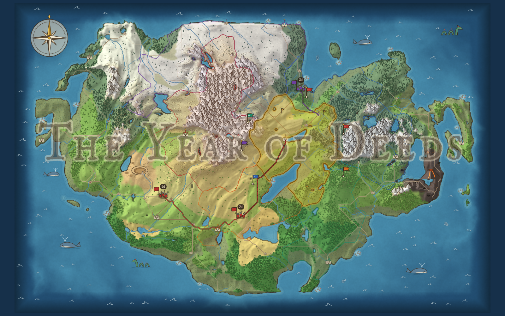
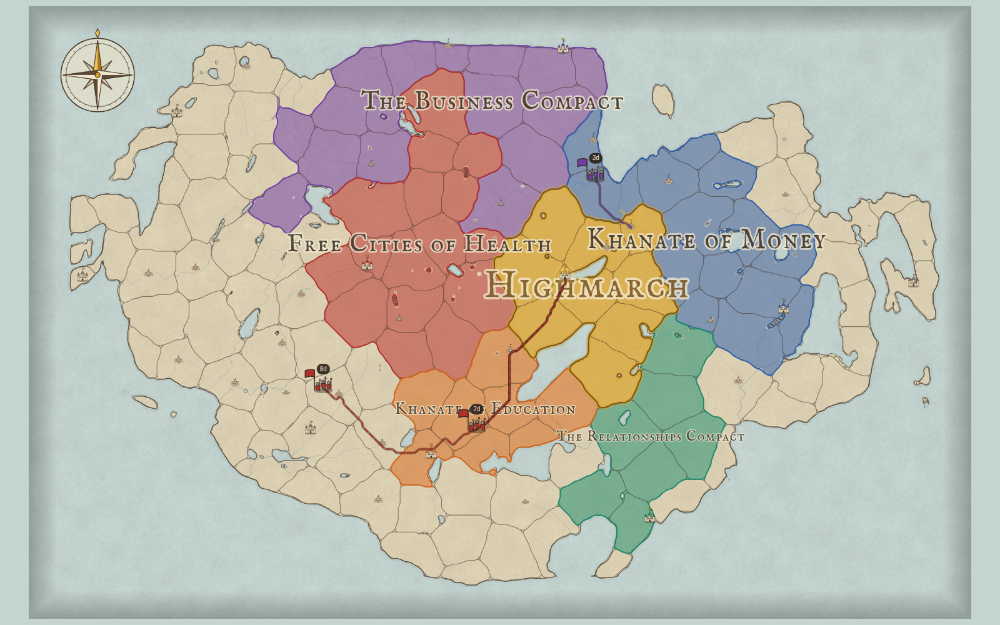
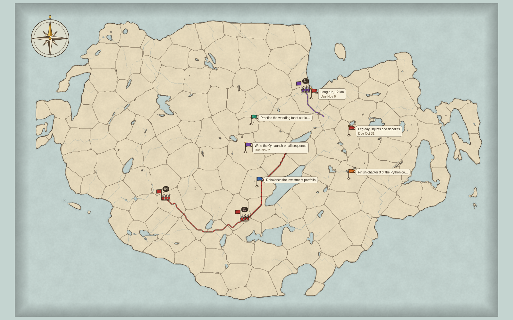
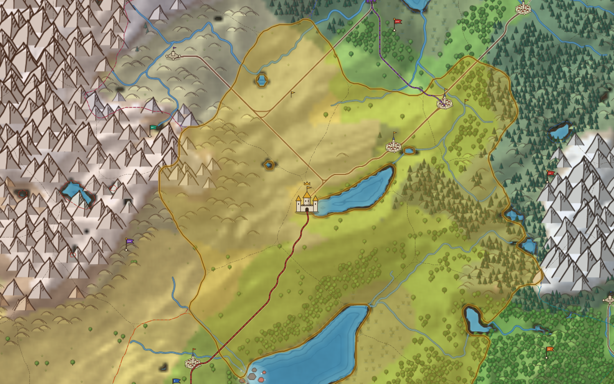
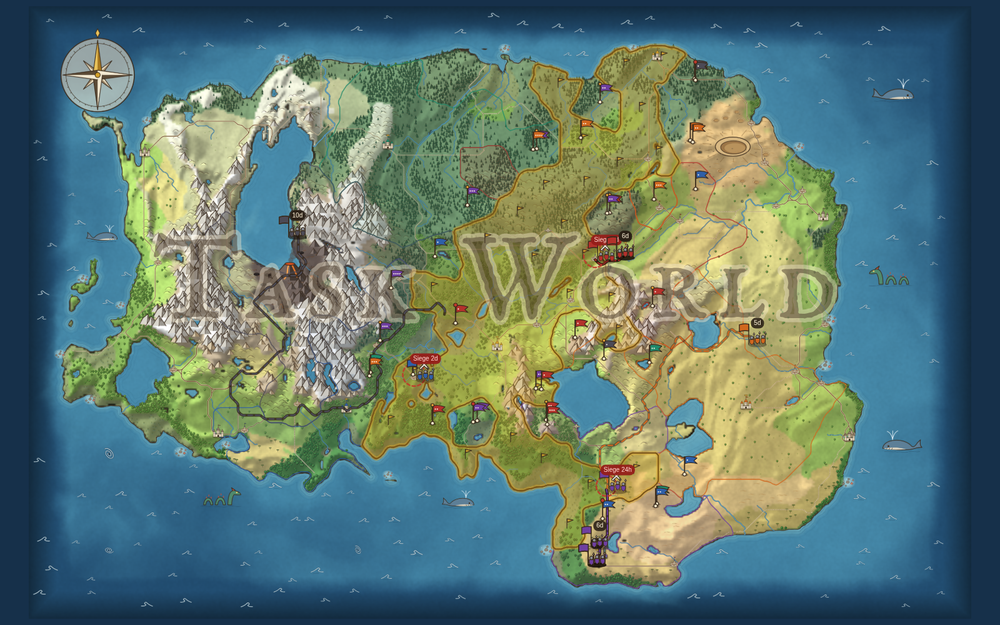

# Task & Conquer

**Your to-do list, played as a war for a fantasy continent.** Every task is a quest pinned to a province of a hand-drawn world. Finish it and the land is yours. Let a deadline slip and a rival army marches on your castle.



## Features

- **A new continent for every world.** Mountains, forests, taiga, deserts, marshes, rivers and lakes, plus a smoking volcano in the ashlands and a meteor crater in the wastes. Castles, forts, towns and villages are joined by roads, and the sea has whales, serpents, whirlpools and reefs. You choose the number of provinces (60–400).
- **Zoom without limits.** The visible area is redrawn at higher resolution as you zoom, so every tree and tower stays sharp.
- **Quests on the map.** Click land that borders your realm to plant a quest. Each quest has a realm, an optional goal, skills, a difficulty, a deadline, notes and subquests. Its status is Planned, In progress or Done. Overdue quests are flagged in red.
- **Realms become rivals.** Each area of your life (Health, Money, Business…) is a rival kingdom on your border. A realm with more goals gets a bigger rival.
- **Deadlines have teeth.** A deadline sends the realm's rival marching on your nearest settlement. Goals launch campaigns a week before they're due, or after a week of neglect. Mountains, ashlands and craters slow armies down. Finish the quest in time and the enemy is defeated; wait too long and the siege ends in looting.
- **Gold and glory.** Provinces and settlements pay gold every day. Gold buys raiding expeditions into faraway lands. Wealth ranks run from *Starving Tribe* to *Owner of All the Gold*, and power ranks from *Tribe in a Muddy Field* to *Worldwide Empire*.
- **Your knight.** A character card shows a full knight inside a radial chart of your skills. You define the skills, every finished quest raises them, and they carry over between worlds.
- **Three map views.** The full painted map, a political map with every realm's name across its land, and a quest map with labelled pins, marching armies and sieges.
- **Quest board.** A kanban with Planned, In progress and Done columns.
- **Chronicle.** Notifications for won and lost provinces, ranks, skills, campaigns, sieges and loot.
- **Plain-text storage.** Each world is a Markdown checklist (`maps/<map name>/world.md`) you can read and edit as an ordinary to-do list. Every rule and number lives in `config.yaml`.

| Political map | Quest map |
|---|---|
|  |  |



*Screenshots show an example world with the built-in example quests, two days in.*

## Demo data

This copy comes with an example world and a character, so you can explore without setting anything up:

- **Task World** (`maps/Task World/world.md`): 180 provinces and six realms (Health, Money, Business, Relationships, Education, Home), facing the Kingdom of Health, the Money Empire, the Business Republic, the Kingdom of Relationships, the Education Empire and the Home Republic. It has 10 goals (one already achieved), 63 quests that are planned, in progress, overdue or done, rival armies on the march, and a few settlements under siege.
- `character.md`: eleven skills with levels earned in the demo.



Deadlines in the demo are relative to the day it was created (29 Oct 2026). Open it later and the armies will already have arrived, sieged and looted, and the chronicle will tell you what happened.

## Run it

You need Node.js 18 or newer (the free LTS download from https://nodejs.org). There is nothing else to install.

- **Windows:** double-click `start.bat`. It starts the app and opens http://localhost:4173 in your browser. Keep the black window open while you play; close it to stop the app.
- **Any system:** open a terminal in this folder, run `node server.js`, then open http://localhost:4173. The first screen sets up your world: map name, kingdom and castle, your realms, skills and goals, and the number of provinces. Then you choose your seat on the generated map.

## Files

| Path | What it is |
|---|---|
| `index.html` | The app, built from `src/` by `python3 build.py`. |
| `config.yaml` | Every tunable value: siege days, gold per day, raid costs, ranks, rival names, rewards. |
| `server.js` | Local server and save/load API. |
| `start.bat` | Windows launcher: starts the server and opens the browser. |
| `maps/<map name>/world.md` | One world, as a Markdown checklist plus a state block the app manages. |
| `character.md` | Your skills, shared by every world. |
| `src/` | Source: `page.html` (markup, CSS), `core.js` (map), `game.js` (rules, storage), `ui.js` (interface). |
| `warp/` | Onboarding for AI agents: `AGENTS.md` (instructions), `CONTEXT.md` (vocabulary, schema, config guide), `CLAUDE.md`. |

## Editing your quests as text

Close the app's tab, edit `maps/<map name>/world.md`, then reopen the app:

```markdown
## Realm: Health | id: health
Rival: Duchy of Health

### Goal: Run a half marathon | due: 2027-04-01 | skills: Conditioning | status: open | id: g9p2ed4zb8
- [x] Morning run, 5 km | difficulty: Squire | id: qaowq5945u
- [ ] Long run, 12 km | due: 2026-11-06 | difficulty: Lord | status: in progress | id: q9dpp3w462
- [ ] Book a sports massage | due: 2026-11-10 | difficulty: Squire
```

New lines get an id and a place on the map. Ticked boxes count as completed, with rewards. `warp/CONTEXT.md` has the full format.

## Moving a world between copies

The version on claude.ai keeps its worlds in that browser page, not in this folder. To bring a world over, open it there, go to **World → Export as text**, and copy (or download) both texts. Then start this copy, choose **Import a world** (on the setup screen or in the World tab), paste them in, and press Import. The world is saved to `maps/<map name>/world.md` and your skills to `character.md`.

## Testing armies

With `debug.time_travel: true` in `config.yaml`, the notifications panel has "Skip 1 day" and "Skip 7 days" buttons. They move that world's clock forward so you can watch campaigns, sieges and looting play out. Set it to `false` for real play.
